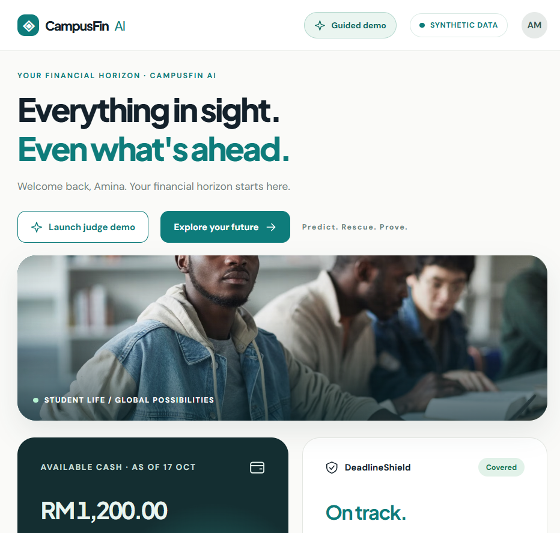
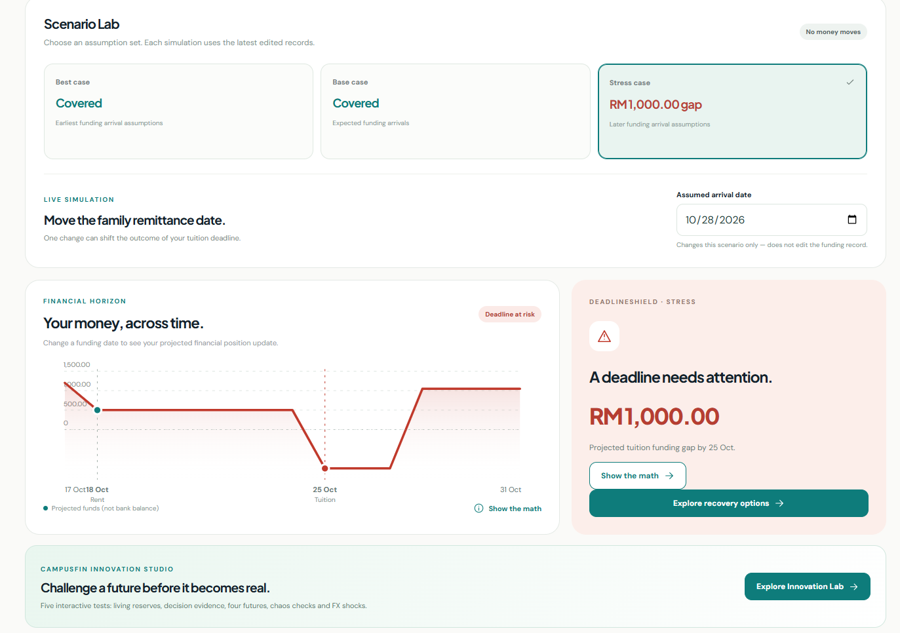
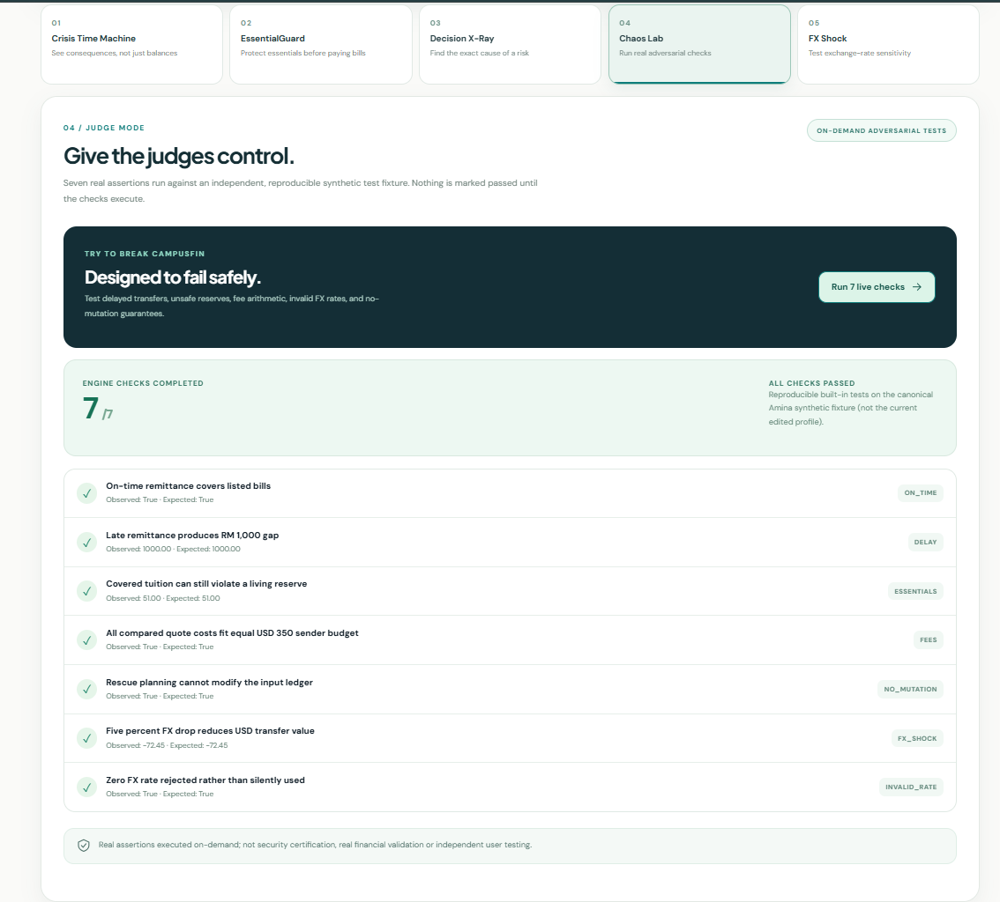

<div align="center">

# CampusFin AI

### Predict. Rescue. Prove.

**An AI-assisted financial safety net for international students.**

*Know what is coming. Understand what is at risk. Make the next decision with evidence.*

**F&F — Fund & Flow** · **CampusFin Labs** · **FinTechathon 2026**  
International AI Track · Topic C: Cross-border & Student Finance Assistant

[**Launch CampusFin AI**](https://campusfin-ai-two.vercel.app/) · [**Explore the code**](https://github.com/chitko84/campusfin-ai) · [**Technical documentation**](docs/TECHNICAL_DOCUMENTATION.md)

</div>

<p align="center">
  
</p>

## Why CampusFin AI?

A student can have money on the way and still be unable to pay a bill on time.

International students often plan around several moving pieces: family transfers sent in another currency, scholarships with uncertain arrival dates, part-time income, rent, and tuition payments that cannot simply be postponed. A monthly budget may appear healthy even when the cash required for a specific deadline will not arrive until days later.

**CampusFin AI focuses on the question traditional balance-only views can miss: _Will the money be available when it is needed?_**

The application turns dated funding assumptions and obligations into an inspectable financial timeline. It identifies emerging shortfalls, compares conditional recovery options, and explains why a recommendation may or may not work. Its conversational assistant can help students explore “what if” questions, while the actual financial arithmetic remains in a deterministic Python engine.

CampusFin is a **financial planning and decision-support prototype**, not a wallet, lender, bank, remittance operator, or payment processor.

## One system. Three connected decisions.

| **01 · Predict** | **02 · Rescue** | **03 · Prove** |
| :--- | :--- | :--- |
| See how upcoming receipts and bills interact on a calendar. | Explore recovery actions without treating unconfirmed help as guaranteed. | Inspect calculations, assumptions, tool activity, and the reasons behind an outcome. |
| **Financial Horizon** · **DeadlineShield** · **Scenario Lab** | **RescueSolver** · **EssentialGuard** · **TransferTruth** · **FamilyBridge** | **ProofCard** · **Decision X-Ray** · **Audit History** |

The result is a connected workflow rather than a collection of unrelated calculators:

```text
Funding sources + due dates + simulated FX assumptions
                         │
                         ▼
              Financial Horizon
                         │
                         ▼
             DeadlineShield alerts
                         │
               Is a bill at risk?
                  /           \
                 No           Yes
                 │             │
          Monitor the      Rescue Planner
             horizon            │
                          Evaluate options
                                │
                     Check essential reserves
                                │
                      ProofCard + next steps
```

## A ten-day delay. A RM 1,000 problem.

Meet **Amina**, a fictional international student in Kuala Lumpur. Her tuition is due before a delayed family remittance arrives.

| Amina's demo records | Amount | Date |
| :--- | ---: | :--- |
| Opening cash | **RM 1,200.00** | 17 October 2026 |
| Rent | −RM 700.00 | Due 18 October |
| Tuition | −RM 1,500.00 | Due 25 October |
| Family remittance | USD 350.00 | Expected 18 October; delayed to 28 October in the stress scenario |
| Scholarship | RM 600.00 | Expected 28 October |

The illustrative family remittance converts to **RM 1,449.00** after a USD 5 deducted fee at the synthetic rate of 4.20 MYR/USD:

```text
(USD 350 − USD 5 fee) × 4.20 MYR/USD = RM 1,449.00
```

**When funding arrives on time**, Amina can cover both rent and tuition, leaving **RM 449** immediately after tuition. **When it arrives on 28 October**, the tuition deadline has a shortfall:

```text
  RM 1,200.00   opening cash
− RM   700.00   rent due 18 Oct
− RM 1,500.00   tuition due 25 Oct
────────────────────────────────
− RM 1,000.00   projected gap at tuition deadline
```

The later remittance and scholarship improve the subsequent financial position, but **funds arriving on 28 October cannot cover a payment due on 25 October**. This distinction is the basis of CampusFin's forecasting and rescue workflow.

<p align="center">
  
</p>

> **Try the scenario:** Open the [live prototype](https://campusfin-ai-two.vercel.app/), enter **Plan**, select **Stress case**, and inspect **DeadlineShield** or **Show the math**. All figures are generated from synthetic records.

## Explore the platform

### Financial Horizon & DeadlineShield

The Financial Horizon creates a date-indexed projection of upcoming funds and obligations. DeadlineShield identifies the first payment with a projected funding gap and shows the amount and due date. The chart distinguishes **projected availability** from an actual bank balance and makes critical dates visible before a student reaches them.

### Funding & commitments

Students can review and edit synthetic funding sources and obligations: amounts, currencies, status, expected arrival windows, due dates, and priorities. Already-settled historical income is treated as part of opening cash, preventing it from being counted again as a future receipt. Forecasts update when editable demo records change.

### Scenario Lab

Compare **best**, **base**, and **stress** assumptions or move a family-remittance date to see its impact. Temporary what-if changes recalculate results **without modifying saved funding records**. This makes it possible to ask, “What happens if the transfer is ten days late?” and compare that future with the original plan.

### Rescue Planner & RescueSolver

When a payment falls short, the system evaluates a focused set of conditional actions:

- **Earlier remittance:** What would change if support arrived before the deadline?
- **Payment extension:** Would a later due date remove the immediate mismatch, subject to university approval?
- **Additional funding:** How much extra support would be required to cover the gap?

Each option is simulated against a copied ledger. The app distinguishes **conditionally feasible**, **insufficient**, and **unconfirmed** outcomes; it never treats hypothetical sponsor funds or institutional approval as received. When no modeled recovery is available, **Funding Gap Summary** explains the unresolved amount and deadline.

### EssentialGuard

Paying tuition is not the only constraint. EssentialGuard checks whether a recovery scenario would leave the student below a **user-selected cash reserve** intended for essentials such as food and transport. A plan can cover a bill and still fail the reserve check. The reserve is a planning threshold, not a clinical or verified cost-of-living estimate.

### TransferTruth

Compare three **fictional USD-to-MYR transfer quotes** using an equal total sender budget. TransferTruth models exchange rates, fee types, the net amount received, and illustrative delivery windows. A reverse calculator estimates the minimum sender budget required to reach a specified MYR recipient amount. **These are sample calculations, not live provider offers.**

### FamilyBridge

Create an editable request for family support or a university payment arrangement using the calculated funding gap. The student reviews the wording and explicitly approves the **saved draft**. Approval does **not** send an email, notify a family member, change a university deadline, or move money.

### Gemini Financial Copilot

Students can ask scenario questions in everyday language—for example, _“What happens if my family transfer arrives on 28 October?”_ The backend recognizes supported date changes, runs the relevant financial tools, and returns a matching scenario and trusted numerical facts. Gemini can provide an explanatory response when the model service is available.

The model is restricted to a **seven-tool, read-only allowlist**. It cannot execute financial payments, settle a remittance, edit ledger records, or approve drafts through those tools. If the model service is unavailable, the interface identifies the result as **offline guidance**, with the financial calculations still produced locally by Python.

### ProofCard & Activity History

**ProofCard** exposes the signed calculation entries and assumptions behind a forecast, making a result such as RM 1,000 traceable to opening cash, rent, tuition, and the timing of future receipts. **Activity History** records selected actions, model-tool activity, and draft changes for inspection in the demo environment.

## Innovation Lab — challenge the decisions

Five interactive modules help examine the system beyond its default happy path:

| Module | What it explores |
| :--- | :--- |
| **Crisis Time Machine** | Four curated futures: earlier funding, delayed funding, missing family support, and an exchange-rate shock. |
| **EssentialGuard** | Whether scheduled payments leave enough of a student-defined essential cash reserve. |
| **Decision X-Ray** | Which date change or funding assumption explains the difference between scenarios. |
| **Chaos Lab** | Seven executable assertions for critical calculations, fees, ledger non-mutation, reserve behavior, and invalid inputs. |
| **FX Shock Absorber** | How hypothetical USD/MYR changes affect incoming funding and forecast outcomes. |

<p align="center">
  
</p>

Chaos Lab's **7/7 successful checks** are reproducible **synthetic-fixture assertions**, not a security certification or proof that every possible scenario is correct.

## Guided product demonstration

The application includes a **six-scene Guided Judge Demo** that walks through the real interface and its working controls:

1. **See the financial picture** — open the dashboard and inspect the student's position.
2. **Watch the deadline collide** — simulate the delayed family remittance and reveal the tuition gap.
3. **Challenge the future** — inspect scenarios and the Innovation Lab.
4. **Validate recovery options** — compare conditional rescue plans and essential-reserve constraints.
5. **Let the AI explain** — examine the Copilot, financial facts, and safe fallback where applicable.
6. **Hand the controls to the judges** — run Chaos Lab's reproducible checks.

To follow the same journey yourself, open the [live application](https://campusfin-ai-two.vercel.app/) and select **Guided demo** from the top bar.

## System architecture

CampusFin uses a responsive React application, a FastAPI service, and a deterministic calculation engine. The language model provides an optional conversational layer **around**, not **instead of**, the financial logic.

```text
                  STUDENT / BROWSER
                          │
                          ▼
                    React + Vite
       Dashboard · Scenarios · Rescue · Copilot
                          │
                     HTTPS /api
                          │
                          ▼
                    FastAPI Layer
          Validation · Routing · Audit Events
                 │                  │
                 ▼                  ▼
          Finance Engine       Gemini Copilot
          Python Decimal     Restricted function calls
          Forecast/Rescue           │
          Fees/ProofCard     Seven read-only tools
                 ▲                  │
                 └──────────────────┘
                          │
                          ▼
                Synthetic Demo Store
               SQLite · Drafts · Audit
```

| Component | Implementation |
| :--- | :--- |
| Web experience | React 18, Vite, responsive CSS, SVG visualizations |
| Backend API | Python, FastAPI, Pydantic request validation |
| Calculations | Date-indexed cash-flow forecasting; `Decimal`-based monetary arithmetic |
| Conversational layer | Gemini `generateContent` API, bounded tool calls, explicit offline fallback |
| Persistence | Synthetic demo dataset, SQLite records, saved drafts, activity events |
| Hosting | Vercel Services: Vite frontend at `/`, FastAPI under `/api/*` |

### Repository layout

```text
campusfin-ai/
├── frontend/
│   ├── src/              # Dashboard, planning, rescue, Copilot, Innovation Lab
│   └── public/           # Optional locally cached student-life photos
├── backend/
│   ├── app/              # API, forecasting, rescue, Copilot, SQLite, demo data
│   ├── tests/            # Automated backend regression tests
│   └── index.py          # Vercel FastAPI entrypoint
├── docs/                 # Technical, security, and feature documentation
├── evidence/             # Recorded tests and source verification artifacts
├── submission/           # Competition materials in the source package
├── scripts/              # Optional photo-download utility
├── vercel.json            # Frontend/backend service routing
└── README.md
```

For implementation-level details, see the [technical documentation](docs/TECHNICAL_DOCUMENTATION.md), [security assessment](docs/SECURITY_SELF_ASSESSMENT.md), and [image credits](docs/IMAGE_SOURCES.md).

## Run CampusFin AI locally

**Prerequisites:** Python 3.10 or newer, Node.js 18 or newer, npm, and Git. The example commands use Windows PowerShell.

Clone the repository:

```powershell
git clone https://github.com/chitko84/campusfin-ai.git
cd campusfin-ai
```

**Terminal 1 — FastAPI backend**

```powershell
cd backend
py -m pip install -r requirements.txt

# Optional: configure a private Gemini API key for live Copilot responses.
$env:GEMINI_API_KEY="YOUR_PRIVATE_API_KEY"
# Optional: use a model identifier supported by your Google AI project.
# $env:GEMINI_MODEL="YOUR_SUPPORTED_MODEL_ID"

py -m uvicorn app.main:app --reload --host 127.0.0.1 --port 8000
```

**Terminal 2 — React frontend** (start at the repository root)

```powershell
cd frontend
npm ci
npm run dev
```

Open **http://localhost:5173**. The Vite development server forwards `/api` requests to the local backend on port 8000. For a backend health check, open **http://127.0.0.1:8000/api/health**.

The model key is optional; forecasting, scenarios, rescue calculations, and labeled offline guidance remain available without it. **Do not commit an API key or place it in frontend environment variables.**

### Verify the implementation

From `backend/`, run:

```powershell
py -m pytest tests/ -q
```

From `frontend/`, verify the production build:

```powershell
npm run build
```

The documented **19 October 2026** backend run passed **72 automated tests**. These cover cash-flow arithmetic, scenario dates, record edits, rescue candidates, transfer calculations, mock Gemini-tool behavior, permissions, and input validation. An additional judge-facing **Chaos Lab** test run completed **7/7 synthetic checks**. Test records and reproduction notes are available in the [`evidence/`](evidence/) directory and the team's supporting execution-evidence report.

These results establish the tested behavior of this prototype; they do not constitute a penetration test, a statistical accuracy benchmark, or a complete multi-browser certification.

## Deployment

The root [`vercel.json`](vercel.json) configures **two Vercel services** within one project: the Vite frontend and the FastAPI backend. Client requests to `/api/*` reach FastAPI through same-origin routing; other paths serve the frontend.

The project is available at **https://campusfin-ai-two.vercel.app/**.

Any Gemini key must be configured as a **backend-accessible Vercel environment variable**, never as a public `VITE_*` secret. The application supports a clear offline fallback when Gemini is unavailable or exceeds its access limits.

### Prototype boundaries

- **Synthetic data only:** Amina is a fictional profile; no actual student financial information is required.
- **No money movement:** There are no real bank transfers, payouts, loan originations, or payment settlements.
- **Simulated FX quotes:** Rates, fees, and delivery windows are illustrative; no live-provider quotation is retrieved.
- **No production user accounts:** Application-level authentication and per-user authorization are not implemented.
- **Temporary hosted storage:** Vercel's SQLite file uses ephemeral runtime storage, so edits, drafts, and audit history are not guaranteed to persist across instances or restarts.
- **No automatic external outreach:** FamilyBridge only prepares and locally approves drafts.

This public demonstration should **not** be used to submit real financial data. Production deployment would require authenticated access, durable tenant-isolated storage, privacy controls, API quotas, and additional security review.

## Where the project can go next

The working prototype establishes the core decision-support workflow. Future development could explore consent-based student pilots, university finance-office collaboration, authenticated accounts, more comprehensive living-cost planning, and authorized real-time remittance quotations. Any real-money functionality would require a separate regulatory and security evaluation.

## CampusFin Labs

**Albukhary International University · Malaysia**  
**FinTechathon 2026 · International AI Track · Topic C**

| Team member | Contribution |
| :--- | :--- |
| **Chit Ko Ko** | Team Leader · Full-stack development · AI integration · Security assessment |
| **Mohammad Saiful Islam** | Development · Technical documentation · Presentation |
| **Abul Hosen** | Finance lead · Execution evidence · Documentation · Recording support |
| **Zobayer** | Presentation design and slide development |
| **Md Ali Akbar** | Video production and editing |

---

<div align="center">

**CampusFin AI — Predict. Rescue. Prove.**

[**Try the live prototype**](https://campusfin-ai-two.vercel.app/) · [**Browse the source**](https://github.com/chitko84/campusfin-ai)

<sub>Built as an educational FinTechathon 2026 prototype. Financial scenarios, exchange rates, and suggested actions are illustrative. Student-life photography is credited in <a href="docs/IMAGE_SOURCES.md">Image Sources</a>.</sub>

</div>
